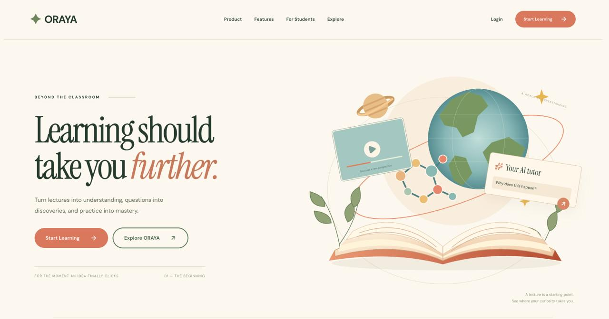
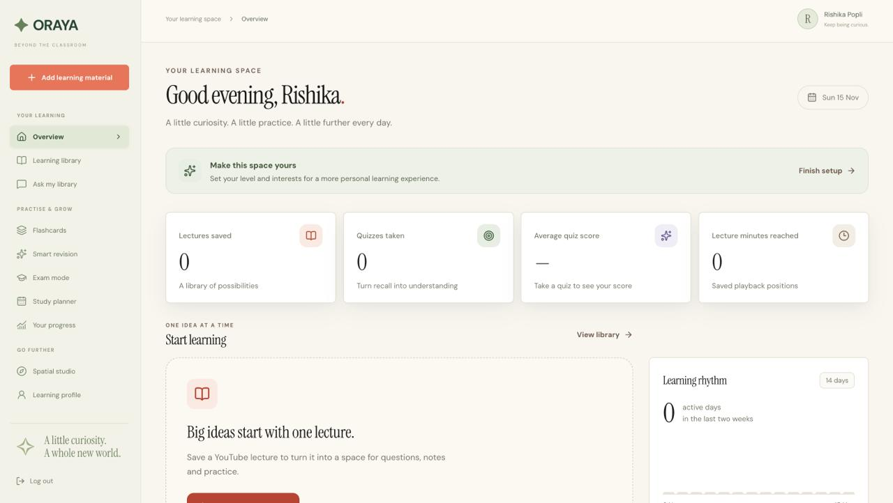
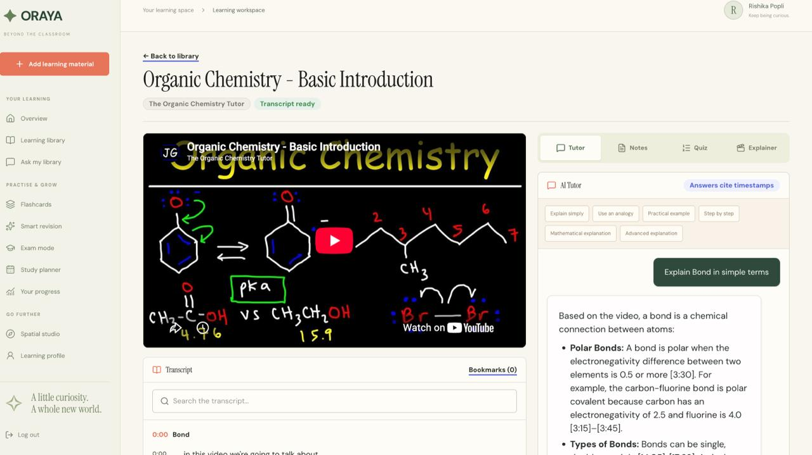
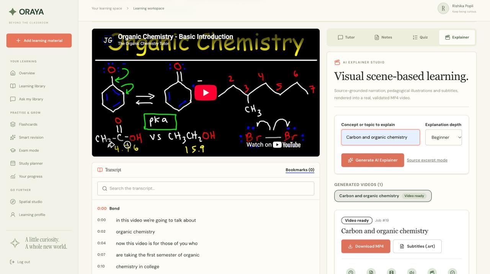
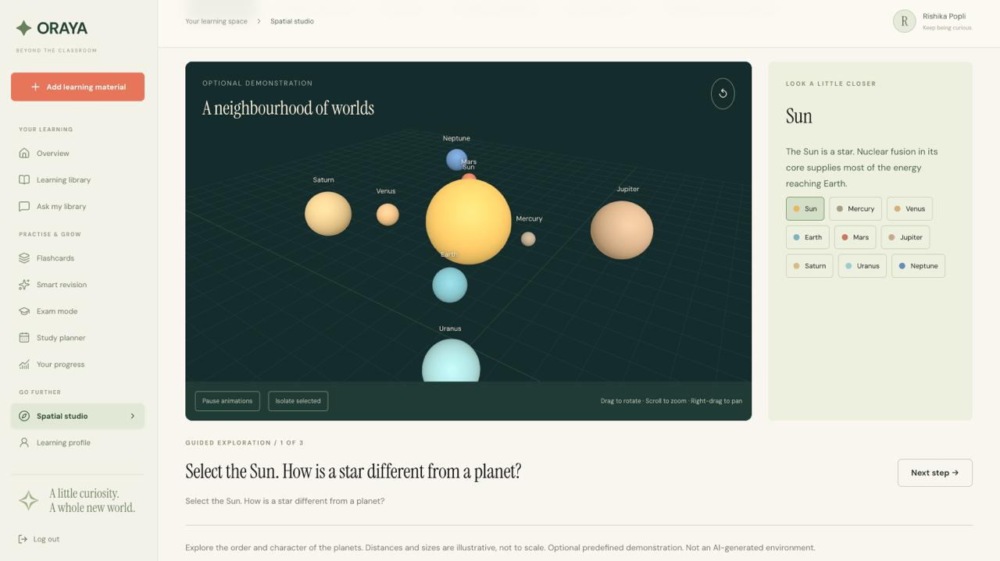

<div align="center">


# ORAYA AI

**Beyond the classroom.**

A learning workspace for studying lectures, asking questions about your materials, and turning what you learn into practice.

[See the workspace](#inside-oraya) · [Run locally](#run-locally) · [Read the setup guide](docs/RUN_INSTRUCTIONS.md)

</div>



## Inside ORAYA

| Study dashboard | Lecture workspace |
| :---: | :---: |
|  |  |
| Pick up where you left off and track study activity. | Search transcripts, bookmark moments, and ask questions in context. |
| **AI Explainer Studio** | **Spatial Studio** |
|  |  |
| Turn a script or source excerpt into a narrated, subtitled animation. | Explore interactive 3D scenes with guided steps and object inspection. |

[See the full screenshot gallery](docs/screenshots/) · [Browse responsive previews](docs/rebuild-screenshots/)

## From lecture to revision

- **Collect your sources.** Add PDF or text materials and lecture transcripts, then use **Ask My Library** to find answers grounded in saved sources.
- **Work through a lesson.** Use the transcript alongside the video and ask the AI Tutor about a specific topic.
- **Practise recall.** Create notes, flashcards, and quizzes. Smart Revision uses the SM-2 spaced-repetition algorithm to schedule reviews.
- **Plan the next session.** Break study goals into watch, revise, and practise sessions and follow your activity from the dashboard.

## Run locally

The supplied setup was verified with Python 3.14 and Node.js 22 or newer. Video rendering requires FFmpeg and FFprobe. Narration defaults to macOS `say`, with gTTS available as an optional provider.

From the repository root, set up the backend.

```bash
python3 -m venv backend/.venv
backend/.venv/bin/python -m pip install -r backend/requirements.txt
python3 scripts/configure_local.py
```

Add `GEMINI_API_KEY` to the generated `backend/.env` to enable Gemini features. These features depend on model access and quota. Manual notes, cards, and revision are available without a key. See the [backend configuration example](backend/.env.example) for optional providers and media settings.

Start the backend in one terminal.

```bash
cd backend
.venv/bin/python -m uvicorn app.main:app --host 127.0.0.1 --port 8000
```

Start the frontend from the repository root in another terminal.

```bash
cd frontend
cp -n .env.example .env
npm ci
npm run dev -- --host 127.0.0.1 --port 5173
```

Open [the app](http://localhost:5173) and create a local account. The [API docs](http://127.0.0.1:8000/api/docs) are available while the backend is running.

## Under the hood

| Area | Implementation |
| --- | --- |
| [Frontend](frontend/) | React, Vite, Tailwind CSS, and Three.js |
| [Backend](backend/) | FastAPI, Pydantic, SQLAlchemy, and SQLite |
| AI and retrieval | Gemini with optional Ollama fallback, plus source retrieval from study materials |
| Explainer video | Application-rendered scenes, text-to-speech narration, FFmpeg assembly, and FFprobe validation |
| [Design system](design-system/) | ORAYA interface and visual design reference |

[Setup and configuration](docs/RUN_INSTRUCTIONS.md) · [Feature matrix](docs/FEATURE_COMPLETION.md) · [Test report](docs/TEST_REPORT.md) · [Known limitations](docs/KNOWN_LIMITATIONS.md)

## License

The source package contains no license file.
